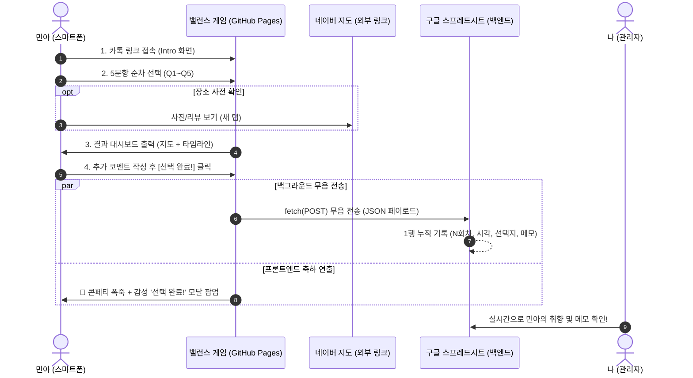

# 🗺️ 00. 전체 아키텍처 및 시스템 흐름도 (Architecture Map)

## 1. 프로젝트 개요
* **프로젝트명**: 제주 여행 취향 밸런스 게임 (`jeju-balance-game`)
* **목적**: 11/13(금) ~ 11/16(월) 3박 4일 제주 여행 일정을 여자친구(민아)가 모바일로 손쉽게 탐색하고 선택할 수 있도록 제공하는 인터랙티브 웹앱.
* **배포 환경**: GitHub Pages (정적 단일 파일 `index.html` 호스팅)
* **백엔드/데이터 저장**: Google Apps Script (Web App POST Webhook) / 구글 스프레드시트 자동 누적

---

## 2. 전체 흐름도 (End-to-End Flow)

---

## 3. 화면별 상태(Screen State) 구성

| 화면 ID | 화면 명칭 | 주요 구성 요소 |
| :--- | :--- | :--- |
| `intro-screen` | 인트로 화면 | 여행 기본 정보(일정, 고정 카페, 숙소), [밸런스 게임 시작하기] 버튼 |
| `question-screen` | 질문 화면 (Q1~Q5) | [← 이전 질문] 버튼, 프로그레스 바, 질문/설명, 선택지 3개(A/B/C) + [네이버 지도 보기] 버튼 |
| `result-screen` | 결과 및 종합 지도 | 성향 분석 뱃지, Leaflet.js 동선 지도(필터 탭 지원), 타임라인 카드, 메모 입력창, [선택 완료!] 버튼, [요약 텍스트 복사] 버튼 |
| `complete-modal` | 감성 축하 모달 | 오렌지 테마 축하 팝업, 감성 텍스트 카드, [지도 다시 보기] / [다시 하기] 버튼 |

---

## 4. 보안 및 무음 전송(Stealth Architecture) 원칙
1. **Zero-UI Warning**: 백그라운드 전송 중 네트워크 상태나 로딩 인디케이터를 일체 노출하지 않음.
2. **Error Suppression**: 네트워크 실패 시에도 콘솔/알림창에 에러를 띄우지 않고 민아에게는 감성 모달만 정상 출력.
3. **Client-side Non-tracking**: 민아의 디바이스(`localStorage` 등)에 카운터나 추적 값을 저장하지 않고 구글 시트에서 100% 카운팅.
